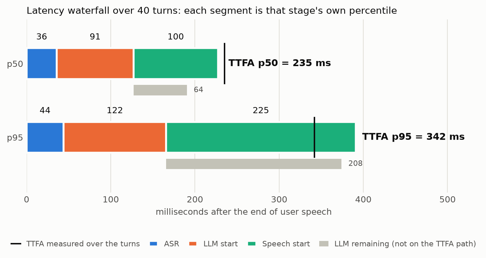

# Assignment 4 report: Hartwell voice agent

> DRAFT. All numbers come from `run_output/7153569/trace.jsonl` or the run folders named next to
> them. Text marked **DRAFT IDEA** is only the main idea for the parts you have to write: check it
> against the numbers and rewrite it in your own words. Delete all the quoted notes like this one
> before submitting.

**Partners:** Tasos Siris (asiris3) and Muyu [last name, Georgia Tech username]  
**Models:** LLM: Llama 3.1 8B Instruct on vLLM. ASR: faster-whisper `small.en`. TTS: Piper `en_US-lessac-medium`.  
**Run behind the figures:** PACE-ICE job 7153569, 8 CPU cores [CPU model] and one H100 GPU, 40 turns, trace file `run_output/7153569/trace.jsonl`

## 1. The system

Our agent is a simple chain: speech to text, then the LLM, then text to speech.

- **ASR:** Whisper transcribes the whole utterance once the user stops talking. It does not stream.
- **LLM, call 1:** picks the intent (set a timer, book a room, and so on) as JSON. This call is not streamed and is never spoken.
- **Rules and task logic:** plain Python reads the numbers, times, days and equipment from the transcript, keeps track of timers, reminders and the booking, and writes the reply.
- **LLM, call 2:** streamed. It repeats the reply from the task logic, or for a lookup question it answers from the knowledge base.
- **TTS:** Piper starts speaking while call 2 is still streaming. We cut the text at the end of each sentence, and the first piece also at the first comma, so audio starts sooner.

Settings that affect time: Whisper and the LLM run on the GPU and Piper runs on the CPU. Both CPU libraries are set to the 8 cores of the job. The full knowledge base goes into the prompt only on lookup turns. Before the first timed turn we run every stage twice as a warm-up.

## 2. The latency waterfall



| | p50 (ms) | p95 (ms) |
|---|---|---|
| **TTFA, all turns** | 235 | 342 |
| ASR: `asr_final` minus `end_of_user_speech` | 36 | 44 |
| LLM start: `llm_first_token` minus `asr_final` | 91 | 122 |
| Speech start: `tts_first_audio` minus `llm_first_token` | 100 | 225 |
| Not on the TTFA path: `llm_complete` minus `llm_first_token` | 64 | 208 |

Turns counted: 40 of 40.

In the figure each bar is that stage's own percentile, so the p95 bars add up to more than the p95 TTFA. The black line is the TTFA measured over the turns.

We also added our own stamps to split the stages further (p50 / p95, in ms):

| Part | p50 | p95 |
|---|---|---|
| LLM call 1 (intent) | 78 | 109 |
| First token of call 2 | 14 | 20 |
| Waiting for the first piece of text | 49 | 103 |
| Piper making the first audio | 56 | 133 |

**How I treat stages that overlap:** `llm_first_token` is the first token of call 2, the one that is spoken. So call 1 is counted inside "LLM start". Piper starts on the first piece while the LLM is still writing, and the wait for that first piece is counted inside "Speech start". The rest of the LLM stream is reported in the last row but it does not delay the first audio.

**How to recompute these numbers:** `python3 waterfall.py --trace run_output/7153569/trace.jsonl --figure report/waterfall.png`

## 3. Word error rate on our own voices

| Speaker | Utterances | Reference words | Pooled WER | Mean WER per utterance |
|---|---|---|---|---|
| Tasos | 20 | 118 | 3.4% | 2.1% |
| Muyu | 20 | 118 | 21.2% | 22.4% |

**DRAFT IDEA:** Whisper is much worse on Muyu's voice, about six times the error rate, even though we both read the same 20 sentences. The mistakes are mostly on the short important words, for example "cancel the eggs timer" was heard as "console the x timer". Muyu's recordings are also quieter and some stop right after the last word, so we cannot say how much is the accent and how much is the recording. It mattered for the tasks: all 6 of Tasos's dialogues worked but only 2 of Muyu's 6, because the agent acted on the wrong words.

> Evidence to check and pick from:
> - Tasos: 4 wrong words in 2 utterances ("set a timer ... eggs" heard as "sit the timer ... egg").
> - Muyu: 25 wrong words. "five" heard as "fife", "tea" as "table", "make it" as "mix it",
>   "Thursday afternoon" as "Thursday after this", and the laundry sentence lost its last two words.
> - Loudness: Muyu's takes peak at about 2,300 to 5,500 out of 32,767, Tasos's at 5,800 to 12,600.
> - Several of Muyu's files end within 0.1 s of the last word (for example `muyu_d03_t03.wav`).

## 4. The bottleneck

**The dominant stage:**

**DRAFT IDEA:** Speech start is the biggest stage: 100 ms out of 235 ms at the median, which is 43% of the TTFA. LLM start is close behind at 91 ms (39%), and ASR is small at 36 ms (15%). So there is no single huge bottleneck, but speech start is the largest and it also grows the most at p95 (225 ms).

**Why:**

**DRAFT IDEA:** Two reasons, and we measured both. First, Piper runs on the CPU while Whisper and the LLM use the GPU, and it takes 56 ms to make the first audio. Second, Piper cannot start until the LLM has finished the first piece of text, which takes 49 ms. Longer first pieces are slower: the three slowest turns (341 to 402 ms) are the long room proposals. When we stopped cutting at the first comma, speech start went from 100 to 119 ms.

> Evidence to check and pick from:
> - Turns where the task logic writes the reply (34 turns): first piece ready after 37 ms, Piper
>   55 ms, TTFA p50 234 ms. Lookup turns (6 turns): first piece 73 ms, Piper 88 ms, TTFA p50 277 ms.
> - Slowest three turns: first piece took 61 to 103 ms to arrive and 122 to 166 ms to synthesize.
> - No comma cut, run `run_output/7153831/`: TTFA p50 253 ms against 235 ms.

**The fix I would ship next:**

**DRAFT IDEA:** For timers, reminders and bookings the reply text is already written by our code before call 2 starts, and the LLM just repeats it. So we would send the first sentence straight to Piper and not wait for the LLM to repeat it. That removes the first token (14 ms) and the wait for the first piece (37 ms on these turns), so about 50 ms on 34 of our 40 turns. We expect the p50 to drop from 235 ms to roughly 185 ms. Lookup turns would stay the same.

> This fix was not measured, only reasoned from the trace, so say that. Other options you could
> pick, with their numbers:
> - Llama 3.2 3B, run `run_output/7153832/`: TTFA p50 213 ms, but it said "fourteen hundred" for the
>   cafe's closing time and took two misheard lines for room names.
> - Piper on the GPU, or a smaller Piper voice: not measured.

**One thing I tried that did not help:**

**DRAFT IDEA:** We set Whisper's beam size to 1 instead of 5, hoping for faster ASR. It saved almost nothing: ASR went from 36 to 34 ms and TTFA from 235 to 230 ms, which is inside the normal variation between runs. But the WER got worse for both of us, 3.4% to 5.9% for Tasos and 21.2% to 24.6% for Muyu. ASR is only 15% of the TTFA, so there was not much to win there, and we kept beam size 5.

> Evidence: run `run_output/7153830/`. Each setting was run once.

## 5. Reproducing this

On PACE-ICE, from the unzipped submission (the same commands are in `README.md`):

```bash
export SCRATCH_DIR=$HOME/scratch
export APPTAINER_CACHEDIR=$SCRATCH_DIR/cache APPTAINER_TMPDIR=$SCRATCH_DIR/tmp
mkdir -p "$APPTAINER_CACHEDIR" "$APPTAINER_TMPDIR"
apptainer build --fakeroot "$SCRATCH_DIR/agent.sif" recipe/agent.def
sbatch run_agent.sbatch
```

The build takes about 4 minutes and the job about 4 minutes. If the login node has no `apptainer`, run the build on a compute node by putting `srun -p ice-cpu --cpus-per-task=8 --mem=32G --time=00:40:00` in front of it.

The job plays the 40 recordings in `recordings/` and writes the trace to `run_output/<job id>/trace.jsonl`, the spoken replies to `tts/`, and the tables and WER to `a4-agent-<job id>.out`. Package versions are pinned in `recipe/requirements.txt`. The LLM runs at temperature 0 with seed 0 (`SEED` in `agent.py`) and vLLM starts with `--seed 42`.

## Appendix: AI-use disclosure

> Check every line here is true for both of you and fix what is not. This part is graded for
> being complete and honest.

**Tools used:** Claude Code (Anthropic), model Claude Fable 5.2. [Add anything else either of you used.]

**What for:** Claude Code wrote the code of the agent (`agent.py`, `dialogue.py`, `nlu.py`), the scripts (`waterfall.py`, `record.py`, `demo.py`), the tests, the pinned requirements and the README. It also built the image, ran the jobs on PACE-ICE and drew the figure. In this report it wrote sections 1, 2 and 5 and filled in the tables. For sections 3 and 4 it listed the measurements and suggested the main idea of each answer, and we [rewrote them / checked them against the trace: say what you actually did].

**What I wrote or decided myself:** [Fill in what is true, for example: we recorded the 40 utterances, chose which run to report, decided to keep beam size 5 and the 8B model, and wrote the final text of sections 3 and 4.]

**How I checked it:** The task logic has 12 unit tests based on the example dialogues in the handout. The course checker passes on all 40 turns of the trace. Every transcript and reply of the run was read in `run_output/7153569/job.out`, which is how an invented "fitness center" answer and two misread numbers were found and fixed. [Add what you checked yourselves, for example listening to the audio in `run_output/7153569/tts/`.]
